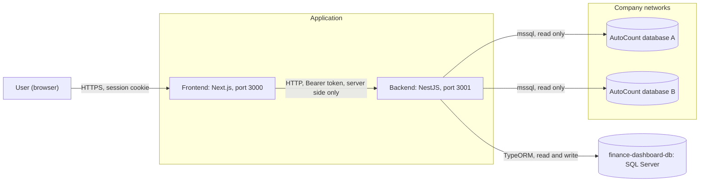
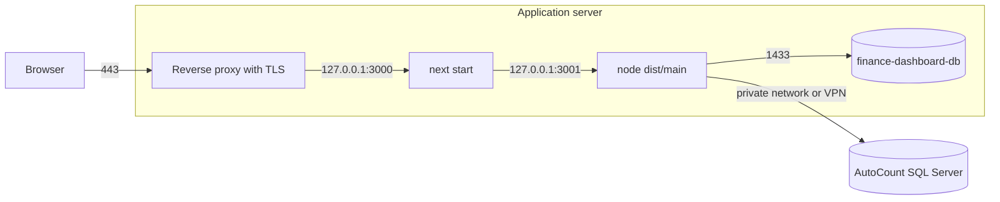
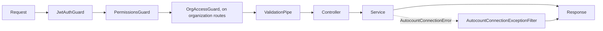
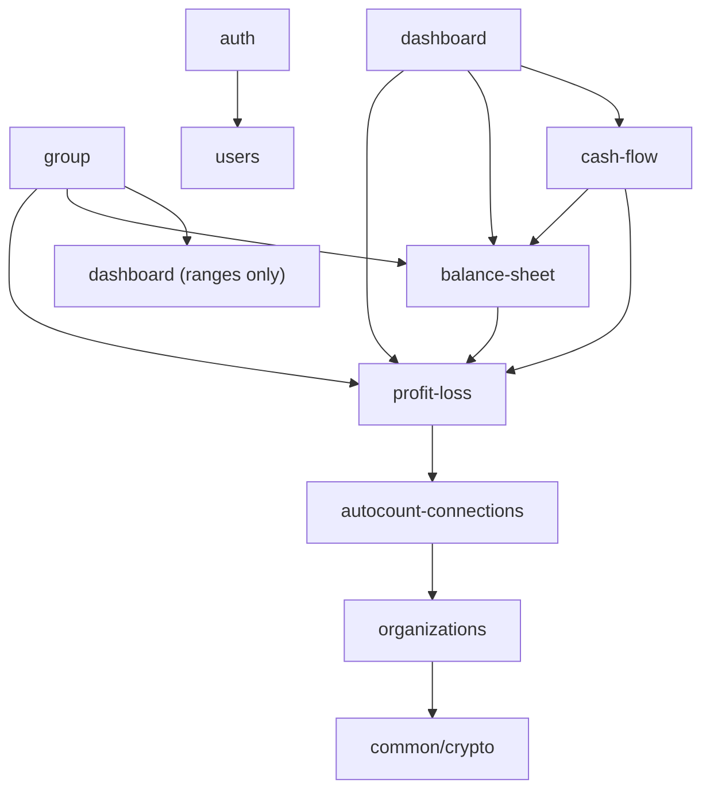
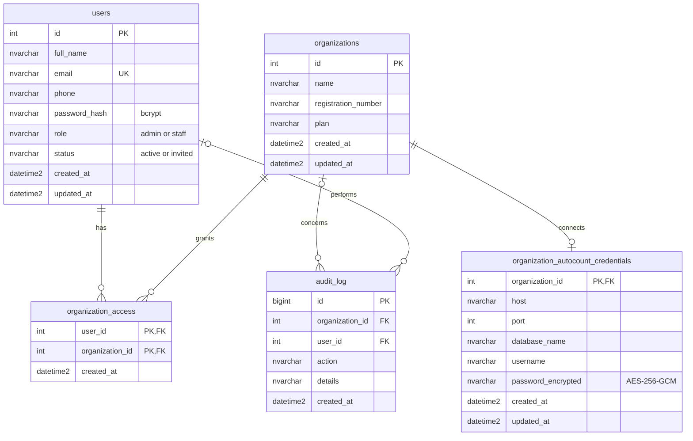
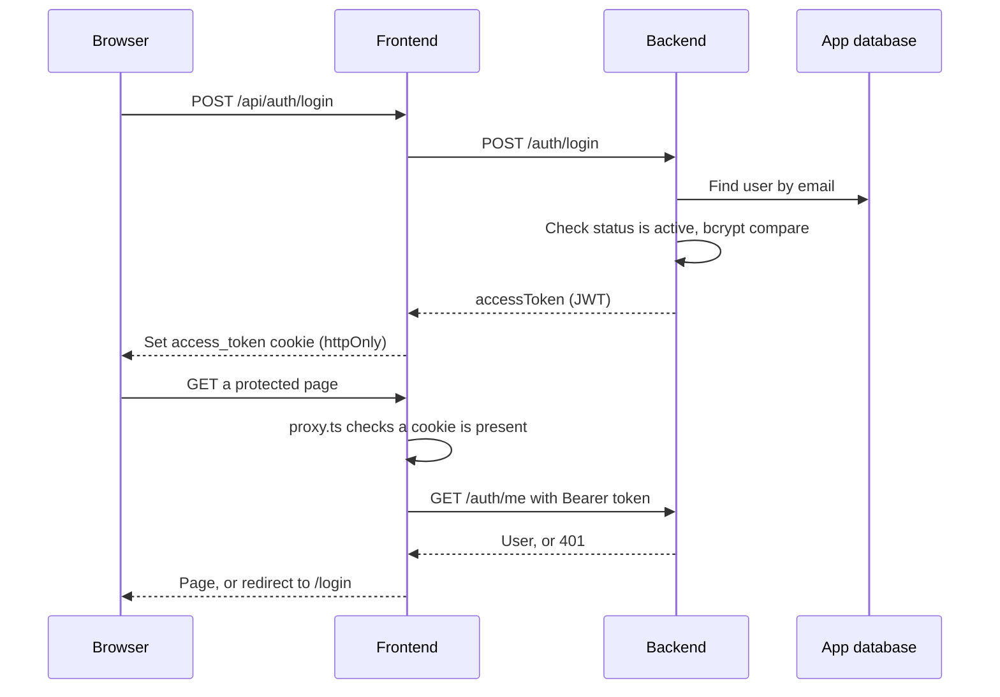
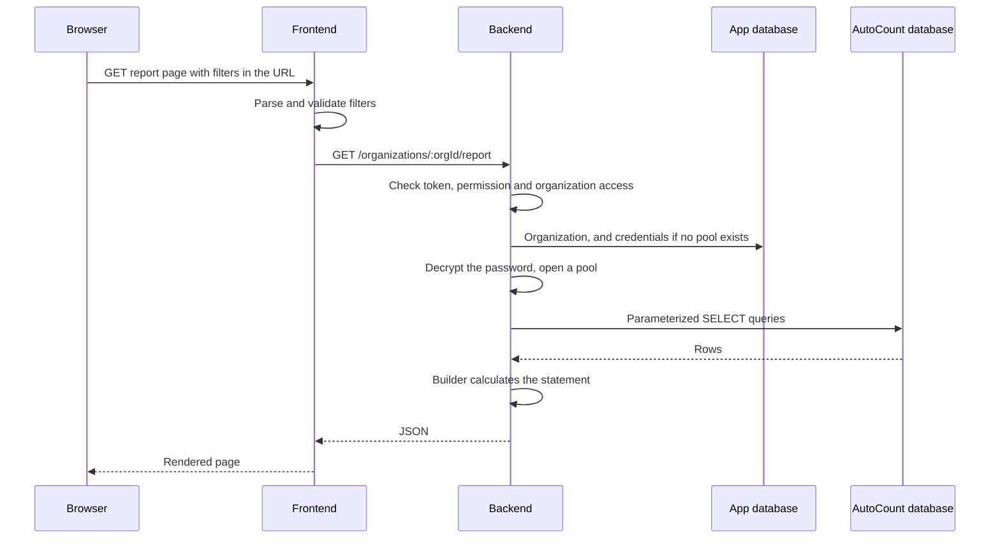
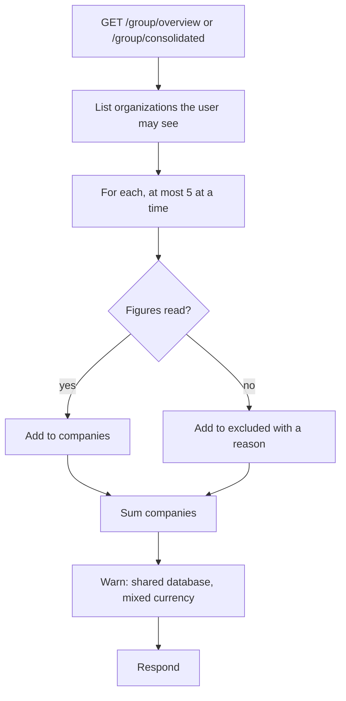

# Architecture

Technical documentation for the Finance Dashboard: `finance-dashboard-fe` (frontend) and `finance-dashboard-be` (backend).

| | |
|---|---|
| Applies to | `main` as of 25 November 2026 |
| Audience | Developers maintaining or extending the system |
| Setup, operation and deployment | [HANDOVER.md](./HANDOVER.md) |
| Supersedes | The May 2026 architecture documents and diagrams (Power BI, staging database, sync agents, AutoCount API). That design was not built |

## Contents

1. [Scope](#1-scope)
2. [System context](#2-system-context)
3. [Technology](#3-technology)
4. [Backend](#4-backend)
5. [Frontend](#5-frontend)
6. [Data](#6-data)
7. [Processes](#7-processes)
8. [Calculation rules](#8-calculation-rules)
9. [API](#9-api)
10. [Security](#10-security)
11. [Error handling](#11-error-handling)
12. [Configuration](#12-configuration)
13. [Design decisions](#13-design-decisions)
14. [Assumptions and limitations](#14-assumptions-and-limitations)
15. [Testing](#15-testing)
16. [Extending the system](#16-extending-the-system)

---

## 1. Scope

The system reads each company's AutoCount SQL Server database and presents financial reports in a web application.

- **In scope:** Profit & Loss, Balance Sheet, Cash Flow, per-organization Dashboard, Group Overview, Consolidated, users and roles, AutoCount connection settings.
- **Out of scope:** writing to AutoCount, storing copies of accounting data, intercompany elimination, currency conversion.

**Outside services:** none. The system calls no third-party API and needs no external account. The frontend's fonts are fetched at build time, so the build needs internet access.

---

## 2. System context



- The browser talks only to the frontend. The backend does not need to be reachable from the internet.
- One AutoCount database per organization. Connection details are stored per organization.
- Accounting data is never persisted by the application.

### Deployment view



Not yet deployed to any environment. Steps are in [HANDOVER.md, section 15](./HANDOVER.md#15-putting-it-online-for-other-people).

---

## 3. Technology

| Layer | Choice |
|---|---|
| Frontend | Next.js 16.2 (App Router, Server Components), React 19, TypeScript, Tailwind CSS 4, shadcn/ui on Base UI |
| Backend | NestJS 11, TypeScript, class-validator, Passport JWT |
| Application database | SQL Server through TypeORM 1.1, with migrations |
| AutoCount access | `mssql` (tedious), raw parameterized SQL |
| Exports | `xlsx` (CSV is built by hand), `jspdf` with `jspdf-autotable` |
| Tests | Jest (backend) |
| Runtime | Node.js `^20.19`, `^22.13` or `>=24.11` |

---

## 4. Backend

### 4.1 Request pipeline



- `JwtAuthGuard` and `PermissionsGuard` are global. A route opts out of login with `@Public()`.
- `OrgAccessGuard` is applied per controller or route.
- `ValidationPipe` uses `whitelist`, `forbidNonWhitelisted` and `transform`, so unknown parameters are rejected.

### 4.2 Modules



| Module | Responsibility | Main files |
|---|---|---|
| `auth` | Login, JWT | `auth.service.ts`, `strategies/jwt.strategy.ts` |
| `users` | Users, own account, organization grants | `users.service.ts`, `account.controller.ts` |
| `organizations` | Organizations, access, encrypted AutoCount credentials | `organizations.service.ts`, `organization-autocount-credentials.service.ts`, `guards/org-access.guard.ts` |
| `autocount-connections` | One connection pool per organization, query helper, typed errors | `autocount-connection-manager.service.ts`, `autocount-query.util.ts` |
| `profit-loss` | Statement, breakdown, trend, transactions, filter options | `profit-loss-statement.builder.ts`, `profit-loss-stock.ts`, `profit-loss-periods.ts` |
| `balance-sheet` | Balance sheet, fiscal year, account grouping and roll-up | `balance-sheet.builder.ts`, `accounts.ts`, `fiscal-year.ts` |
| `cash-flow` | Indirect cash flow | `cash-flow.builder.ts` |
| `dashboard` | One organization's summary | `dashboard.service.ts`, `dashboard-ranges.ts` |
| `group` | Cross-organization reports | `group.service.ts`, `group-totals.ts` |
| `audit-log` | Read endpoint and an unused writer | `audit-log.service.ts` |
| `health` | Status check | `health.controller.ts` |
| `common` | Guards, decorators, roles, encryption, exception filter | |

### 4.3 Report module structure

| File | Role |
|---|---|
| `dto/*-query.dto.ts` | Validated input |
| `dto/*.dto.ts` | Response shape |
| `*.queries.ts` | SQL text only, parameterized |
| `*.service.ts` | Loads rows, calls the builder, adds comparison and notes |
| `*.builder.ts` | Pure calculation with no I/O; covered by unit tests |

### 4.4 AutoCount connection manager

- Keeps a map of organization to `mssql.ConnectionPool`, in least-recently-used order.
- Pools are created on first use and shared by concurrent requests. Failed attempts are not cached.
- Evicted when idle, when over capacity, on a background pool error, or when credentials change.

| Setting | Default |
|---|---|
| Cached organizations | 50 |
| Connections per organization | 5 |
| Idle eviction | 20 minutes, checked every 60 seconds |
| Connection timeout | 8 seconds |
| Query timeout | 30 seconds |

---

## 5. Frontend

### 5.1 Structure

| Path | Contents |
|---|---|
| `app/(public)/login` | Login page |
| `app/(protected)` | Pages that need a login; its layout loads the user and organizations |
| `app/(protected)/organizations/[orgId]/*` | Dashboard, reports and settings of one organization |
| `app/(protected)/group-overview`, `consolidated` | Cross-organization pages |
| `app/api/auth/login`, `logout` | Set and clear the session cookie |
| `proxy.ts` | Redirects requests that have no session cookie |
| `components/statement` | Shared report components |
| `components/{profit-loss,balance-sheet,cash-flow,dashboard,group}` | Report-specific components |
| `components/ui` | shadcn/ui primitives |
| `lib/api.ts` | Server-side fetch wrapper with the token and typed errors |
| `lib/{profit-loss,balance-sheet,cash-flow,dashboard,group}.ts` | Types and data loading |
| `lib/*-params.ts`, `report-params.ts` | Parse and validate URL state |
| `lib/*-rows.ts` | Turn responses into table rows |
| `lib/statement-export.ts`, `report-pdf.ts` | CSV, Excel and PDF |
| `lib/actions` | Server Actions (changes, and transaction drilldown) |
| `config` | Navigation |

### 5.2 Conventions

- Pages are async Server Components and load data during render. No client data-fetching library is used.
- Report state (dates, filters, comparison, view) lives in the URL. `ReportNavigationProvider` updates it in a transition, so the previous figures stay on screen while loading.
- Organization reports share `StatementBlock` rows (`section`, `heading`, `summary`), rendered by `StatementTable` and exported by `buildExportSheet`.
- Charts are plain SVG and HTML; there is no chart library.
- Amounts are formatted by `lib/statement-format.ts`, with negatives in parentheses.
- Next.js 16 differs from earlier versions. Read `node_modules/next/dist/docs` before changing framework code (see `AGENTS.md`).

---

## 6. Data

### 6.1 Application database



Deleting an organization cascades to its access grants and credentials, and sets `audit_log.organization_id` to null. TypeORM also keeps a `migrations` table. `synchronize` is off; the schema only changes through migrations.

### 6.2 AutoCount tables read

| Table | Used for | Columns |
|---|---|---|
| `GLDTL` | Ledger lines | `GLDtlKey`, `AccNo`, `TransDate`, `HomeDR`, `HomeCR`, `ProjNo`, `DeptNo`, `JournalType`, `Description`, `RefNo1` |
| `GLMast` | Chart of accounts | `AccNo`, `Description`, `AccType`, `SpecialAccType`, `ParentAccNo`, `CashFlowCategory`, `CurrencyCode` |
| `AccGroup` | Report group and sign | `AccType`, `Group`, `NormalBalance`, `Seq` |
| `AccType` | Section names | `AccType`, `Description` |
| `OBalance` | Opening balances | `PeriodNo`, `AccNo`, `HomeDR`, `HomeCR`, `ProjNo`, `DeptNo` |
| `FiscalYear` | Fiscal year dates | `FromDate`, `ToDate` |
| `StockSet`, `StockPBalance` | Stock accounts and month-end values | `OpenStock`, `CloseStock`, `BalanceStock`, `PeriodNo`, `Balance`, `ProjNo`, `DeptNo` |
| `Budget`, `BudgetPBalance` | Budgets | `BudgetKey`, `BudgetName`, `PeriodNo`, `AccNO`, `Amount`, `ProjNo`, `DeptNo` |
| `Project`, `Dept` | Filters | Code and `Description` |

### 6.3 AutoCount facts relied on

Checked against AutoCount's sample company unless marked as an assumption.

- `PeriodNo = year * 12 + month`.
- Opening balances are in `OBalance` only, not in `GLDTL`.
- Profit is not posted to retained earnings.
- `AccGroup.Group`: `AS` and `FN` are balance sheet groups; other groups are profit and loss.
- `SpecialAccType`: `SBK` bank, `SCH` cash, `SBS` stock, `SDC` and `SDR` debtor control and debtor, `SCC` and `SCR` creditor control and creditor, `SFA` fixed asset, `SAD` accumulated depreciation, `SOS` and `SCS` opening and closing stock, `SRE` retained earnings.
- `CashFlowCategory`: `O`, `I` or `F`; the column default is `O`.
- `HomeDR` and `HomeCR` are home currency. `DR` and `CR` are in the account's currency, so they cannot be added across accounts. *(Assumption from the column names; the sample has one currency.)*

---

## 7. Processes

### 7.1 Login



### 7.2 Viewing a report



Clicking an amount calls a Server Action, which requests the report's `/transactions` endpoint in the same way.

### 7.3 Group reports



### 7.4 Connecting an organization

1. An admin saves host, port, database, username and password.
2. The backend encrypts the password, stores it, and drops any existing pool.
3. **Test Connection** opens a new pool with the stored credentials.

---

## 8. Calculation rules

Amounts are rounded to 2 decimals per account. Every statement query uses the home currency columns.

### 8.1 Account grouping

| Report section | Rule |
|---|---|
| Sales, sales adjustments, cost of goods sold, other incomes, expenses, taxation | `AccType` `SL`, `SA`, `CO`, `OI`, `EP`, `TX` |
| Non-current assets | `FA`, `OA` |
| Current assets | `CA` |
| Equity | `CP`, `RE` |
| Non-current liabilities | `LL`, `OL` |
| Current liabilities | `CL` |
| Custom types in group `AS` | Current assets, or current liabilities when the normal balance is credit |
| Custom types in group `FN` | Non-current liabilities |
| Other types (`EI`, `AP`, other custom) | Not in the Profit & Loss; included in equity on the Balance Sheet |

Sign follows `AccGroup.NormalBalance`. Individual debtors (`SDR`) and creditors (`SCR`) are rolled into their control account on the Balance Sheet and Cash Flow. Account names are never used to classify.

### 8.2 Profit & Loss

```
net sales            = SL - SA
cost of goods sold   = CO + opening stock - closing stock
gross profit         = net sales - cost of goods sold
net profit           = gross profit + OI - EP
net profit after tax = net profit - TX
```

- `%` columns are relative to gross sales (`SL`).
- Prior year shifts the range back one year; a month-end stays a month-end.
- Budget sums every month the range touches.
- Breakdown: calendar months or quarters, at most 36 months.
- Trend: monthly net sales for a calendar year and the year before.

### 8.3 Stock

Stock values are month-end amounts held outside the ledger.

- Opening stock is the latest value **before** the range's first month; closing stock is the latest value **up to** its last month.
- A month with no value uses the most recent earlier one, and a note says so.
- They are applied to the accounts named by `StockSet.OpenStock` and `CloseStock`.
- With a project or department filter, only values with that tag are used.

### 8.4 Balance Sheet

```
account balance      = opening balance + ledger movement up to the date
stock asset          = latest stock value, replacing any opening balance on that account
current year profit  = Profit & Loss from fiscal year start to the date
other current year   = EI, AP and other profit and loss types in the year
brought forward      = all accumulated profit - current year profit - other current year
out of balance       = total assets - total liabilities - equity
```

- Accumulated profit includes stock value, less any opening stock already in the opening balances. Opening stock is recognised as an opening balance on the stock account, or as a gap in the opening balances equal to the stock value of the month before they start.
- Fiscal year start: the `FiscalYear` row containing the date; otherwise its pattern is continued; otherwise 1 January.

### 8.5 Cash Flow (indirect)

```
operating   = net profit after tax + depreciation added back + changes in operating accounts
investing   = changes in investing accounts
financing   = changes in financing accounts
net change  = operating + investing + financing
unreconciled = closing cash - opening cash - net change
```

- Cash is accounts with `SpecialAccType` `SBK` or `SCH`.
- Section: `CashFlowCategory`. Without one, `FA` and `OA` are investing, `CP`, `LL`, `OL` and `AP` are financing, and the rest operating; moved accounts are listed in a note. Accounts labelled operating whose type suggests otherwise are also listed.
- Credits to accumulated depreciation (`SAD`) are added back; debits are shown in the account's own section.
- Profit and loss accounts labelled investing or financing are moved out of operating.
- Stock values are cancelled out, because they are not cash.
- Opening balances count as cash already held, even if the books opened during the period.

### 8.6 Dashboard and Group

- Month to date; fiscal year to date; the 12 months ending on the date; each with the prior year.
- The Dashboard and Group screens use the same builders and services as the reports.
- Group totals are plain sums.

### 8.7 Invariants

Any change must keep these true:

1. Balance Sheet current year profit equals Profit & Loss net profit after tax for the same dates.
2. Cash Flow closing cash equals the Balance Sheet's cash and bank.
3. Assets equal equity plus liabilities when the ledger and opening balances balance.
4. Dashboard and Group figures equal the reports for the same dates.
5. Breakdown columns add up to the total for net sales, gross profit and net profit.

---

## 9. API

JSON over HTTP. All routes need `Authorization: Bearer <token>` except `POST /auth/login` and `GET /health`. Dates are `YYYY-MM-DD`.

| Method and path | Access |
|---|---|
| `POST /auth/login`, `GET /health` | Public |
| `GET /auth/me`, `PATCH /account`, `PATCH /account/password` | Any user |
| `GET /organizations` | Any user (staff see only their own) |
| `GET /organizations/:orgId` | Organization access |
| `POST /organizations`, `PATCH` and `DELETE /organizations/:orgId` | Admin |
| `GET` and `PUT /organizations/:orgId/settings/database`, `POST .../test-connection` | Admin |
| `GET /organizations/:orgId/audit-log` | Admin |
| `GET` and `POST /users`, `GET`, `PATCH` and `DELETE /users/:id` | Admin |
| `GET` and `POST /users/:id/organizations`, `DELETE /users/:id/organizations/:orgId` | Admin |
| `GET /organizations/:orgId/profit-loss`, and `/breakdown`, `/trend`, `/transactions`, `/filters` | Organization access |
| `GET /organizations/:orgId/balance-sheet`, and `/transactions` | Organization access |
| `GET /organizations/:orgId/cash-flow`, and `/transactions` | Organization access |
| `GET /organizations/:orgId/dashboard` | Organization access |
| `GET /group/overview`, `GET /group/consolidated` | Any user (own organizations only) |

Parameters and notes are in the endpoint table in [BACKEND_INTEGRATION.md](./BACKEND_INTEGRATION.md#full-api-reference). Transaction endpoints return the latest 1,000 lines, with totals over all of them.

---

## 10. Security

| Area | Implementation |
|---|---|
| Passwords | bcrypt, 10 rounds |
| Session | Stateless JWT (default 1 day) in an httpOnly, SameSite=Lax cookie; Secure in production |
| Roles | `admin`, `staff`, global per user. Permissions are defined in `common/auth/role.ts` |
| Organization access | Admins see all; staff need a row in `organization_access` |
| AutoCount passwords | AES-256-GCM with `CREDENTIALS_ENCRYPTION_KEY`; never returned by the API |
| AutoCount access | `SELECT` statements only. Use a SQL login with `db_datareader` |
| SQL injection | All values bound as parameters |
| Input | DTO validation; unknown fields rejected |
| CSV export | Text that starts like a formula is escaped |

**Known gaps**

- SQL Server connections use `encrypt: false`. Keep them on one machine, a private network or a VPN.
- `GET /health?orgId=` is public, opens a connection, and returns raw connection error text. Do not expose the backend publicly.
- No login attempt limit, password reset or token revocation. Blocking a user takes effect when the token expires.
- Name and role come from the token, so changes show after the next login.
- The audit log is never written.

---

## 11. Error handling

| Situation | Response |
|---|---|
| Invalid input | 400 |
| Missing or invalid token | 401 |
| No permission or organization access | 403 |
| Unknown organization or budget | 404 |
| AutoCount not configured (`NOT_CONFIGURED`) | 424 |
| AutoCount login failed (`AUTH_FAILED`) | 502 |
| AutoCount unreachable (`UNREACHABLE`) | 503 |
| Other AutoCount connection failure (`UNKNOWN`) | 502 |
| Anything else, including a failed AutoCount query | 500 |

AutoCount connection errors have the form `{ statusCode, reason, message }`. Report pages show connection errors, 400 and 404 in place, so filters stay usable. Group reports never fail because of one organization; query details are logged, not returned.

---

## 12. Configuration

| Variable | Part | Required | Purpose |
|---|---|---|---|
| `APP_DB_HOST`, `APP_DB_PORT`, `APP_DB_USERNAME`, `APP_DB_PASSWORD`, `APP_DB_NAME` | Backend | Yes | Application database |
| `JWT_SECRET` | Backend | Yes | Signs tokens |
| `JWT_EXPIRES_IN` | Backend | No (`1d`) | Token lifetime |
| `CREDENTIALS_ENCRYPTION_KEY` | Backend | Yes | 32 bytes, base64 |
| `CORS_ORIGIN` | Backend | No | Allowed browser origins |
| `PORT` | Backend | No (`3001`) | Listening port |
| `AUTOCOUNT_POOL_*`, `AUTOCOUNT_*_TIMEOUT_MS` | Backend | No | See 4.4 |
| `ADMIN_EMAIL`, `ADMIN_FULL_NAME`, `ADMIN_PASSWORD` | Backend | Once | `bootstrap:admin` script only |
| `BACKEND_API_URL` | Frontend | No (`http://localhost:3001`) | Backend address, read on the server |

How to obtain each value is in [HANDOVER.md, section 5](./HANDOVER.md#5-step-3-set-up-the-backend).

---

## 13. Design decisions

| Decision | Reason | Consequence |
|---|---|---|
| Web application instead of Power BI | Replaces the May 2026 proposal | No staging database, sync agents or Power BI licences |
| Read AutoCount live | Always current; no sync jobs or copies to secure | Speed depends on AutoCount; no reports when it is off |
| SQL instead of AutoCount's API | Full ledger access for reports, read only | Depends on AutoCount's table structure |
| `mssql` for AutoCount, TypeORM for our own tables | AutoCount's schema is not ours to model or migrate | SQL is written by hand |
| AutoCount's own classifications | Names differ between companies and languages | No EBITDA or expense groups without account mapping |
| Calculations in pure builders | Testable without a database | Services only load data and compose |
| Dashboard and Group reuse report code | Figures cannot drift apart | Some queries are repeated |
| One global role per user | Simple to manage | No per-organization roles |
| JWT in an httpOnly cookie, backend called from the server | Token is not readable by scripts; backend can stay private | Every request passes through the frontend |
| Filters in the URL | Shareable, reload-safe | Invalid values must be handled |
| Failing organizations excluded from group totals | One outage must not hide the rest | Totals may be incomplete, and say so |
| No chart library | Few, simple charts | New chart types need more work |

---

## 14. Assumptions and limitations

**Verification status**

| Item | Status |
|---|---|
| Profit & Loss before 25 November 2026 | Compared with AutoCount's figures by the development team, on AutoCount's sample company |
| The same figures after the changes | Unchanged on that database for three date ranges |
| Taxation, budgets, stock, project and department filters | Tested with made-up data only; the sample company has none |
| Balance Sheet, Cash Flow, Dashboard, Group | Reconciled with each other; not compared with AutoCount's reports |
| Production data | Not tested |

**Assumptions to confirm**

1. Budget amounts are positive in each account's natural balance.
2. A month without a stock value carries the previous value forward.
3. The first stock value ever recorded counts as profit in full, as there is no earlier value.
4. Opening stock is represented in one of the two ways in 8.4.
5. `OBalance` holds a single set of opening balances.
6. `OL` accounts are non-current.
7. `CashFlowCategory` is set correctly; `O` may be an unchanged default.
8. Fixed deposits are cash only when marked `SBK` or `SCH`.
9. Debtors and creditors sit directly under their control account.

Functional limitations are in [HANDOVER.md, section 16](./HANDOVER.md#16-known-limitations).

---

## 15. Testing

Backend (`npm test`): 77 unit tests covering the builders, periods, stock, fiscal year, date ranges, group totals and isolation, guards and the connection manager. No database is needed. `npm run test:e2e` needs a migrated application database.

The frontend has no automated tests; use `npm run typecheck`, `npm run lint` and `npm run build`.

After changing a calculation, check the invariants in 8.7 against a database whose AutoCount figures are known.

---

## 16. Extending the system

**Add a report**

1. Backend: new module with DTOs, queries, builder with tests, service and controller. Use `@RequirePermissions(Permission.ReportView)` and `OrgAccessGuard`.
2. Frontend: types and loader in `lib`, URL params, row builder, components reusing `components/statement`, page and `loading.tsx`, and an entry in `config/nav.ts`.
3. Update the endpoint table in `BACKEND_INTEGRATION.md`.

**Change the application database**

1. Change the entity, then `npm run migration:generate -- src/migrations/Name`.
2. Review the migration, then `npm run migration:run`. Never edit a migration that has been released.

**Add a permission or role:** `common/auth/role.ts`, then `@RequirePermissions` on the routes, then the frontend navigation.

Planned improvements are in [HANDOVER.md, section 17](./HANDOVER.md#17-ideas-for-further-improvement).
